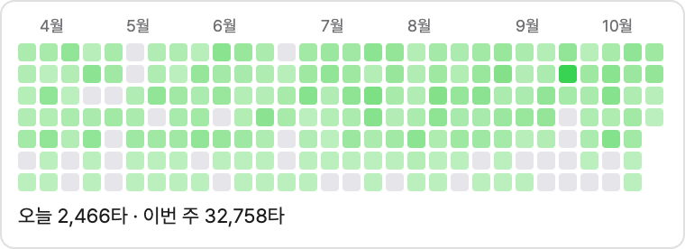
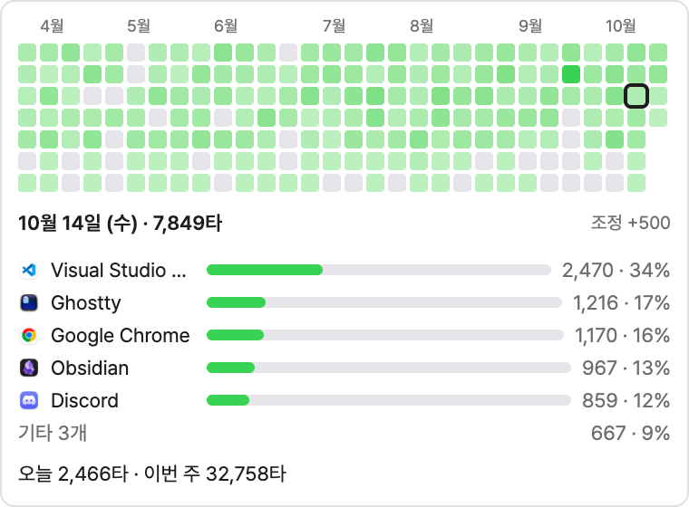
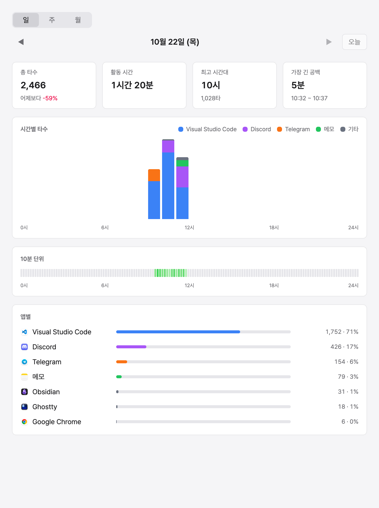
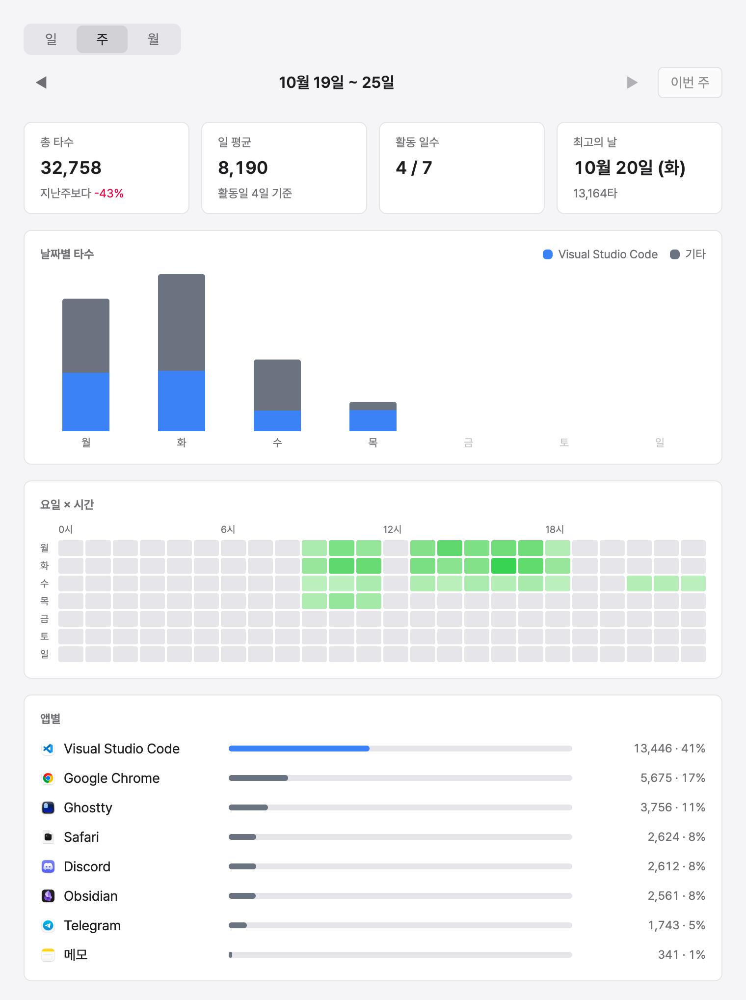
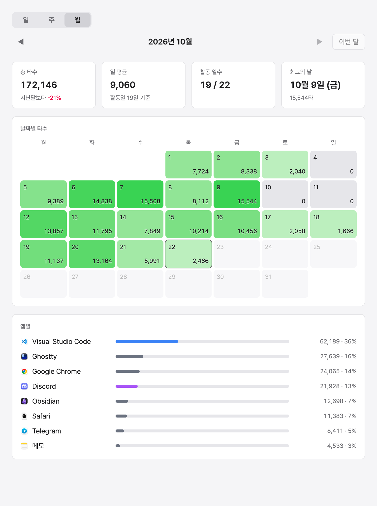
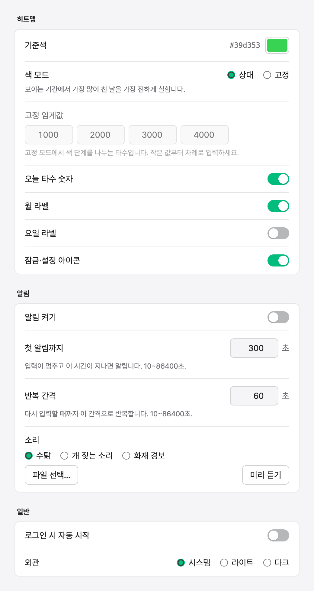
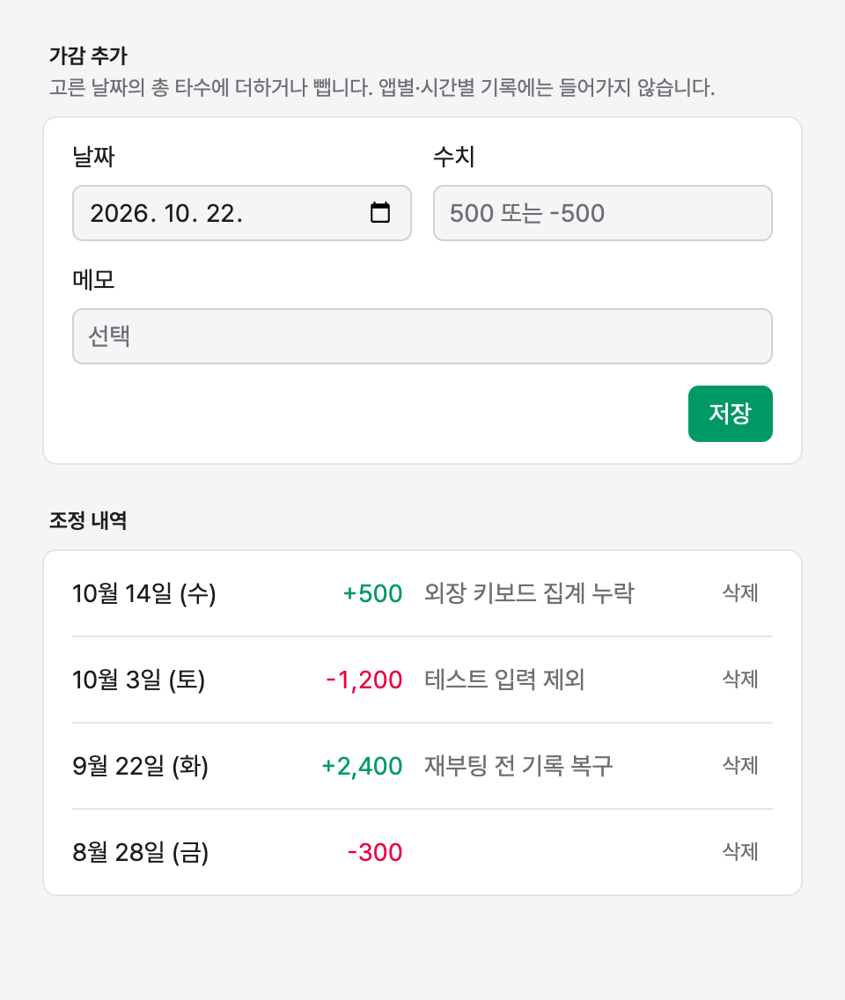

# today-is-deadline

활성 앱별 키다운 횟수를 세어 GitHub 잔디 모양 히트맵 위젯으로 늘 화면 위에 띄워 두는 데스크톱 앱이다. 키 수집은 없다.

- 히트맵 칸을 누르면 그날의 앱별 타수를 펼쳐 보여 준다.
- 통계 창에서 일·주·월 단위로 시간대별 타수와 앱별 누적을 본다.
- 입력이 멈추면 정해 둔 시간 뒤부터 소리로 알린다.
- 시스템 외관을 따르는 라이트·다크 모드. 설정에서 고정할 수 있다.
- macOS(Apple Silicon·Intel)와 Windows 11(x64)을 지원한다.

## 화면

**위젯.** 칸을 누르면 그날의 앱별 타수가 펼쳐진다.

<table>
<tr>
<td valign="top">
<picture>
  <source media="(prefers-color-scheme: dark)" srcset="docs/screenshots/dark/widget.png">
  
</picture>
</td>
<td valign="top">
<picture>
  <source media="(prefers-color-scheme: dark)" srcset="docs/screenshots/dark/widget-expanded.png">
  
</picture>
</td>
</tr>
</table>

**통계.** 일·주·월.

<table>
<tr>
<td valign="top">
<picture>
  <source media="(prefers-color-scheme: dark)" srcset="docs/screenshots/dark/stats-day.png">
  
</picture>
</td>
<td valign="top">
<picture>
  <source media="(prefers-color-scheme: dark)" srcset="docs/screenshots/dark/stats-week.png">
  
</picture>
</td>
<td valign="top">
<picture>
  <source media="(prefers-color-scheme: dark)" srcset="docs/screenshots/dark/stats-month.png">
  
</picture>
</td>
</tr>
</table>

**설정과 가감.**

<table>
<tr>
<td valign="top">
<picture>
  <source media="(prefers-color-scheme: dark)" srcset="docs/screenshots/dark/settings.png">
  
</picture>
</td>
<td valign="top">
<picture>
  <source media="(prefers-color-scheme: dark)" srcset="docs/screenshots/dark/adjust.png">
  
</picture>
</td>
</tr>
</table>

## 설치

[Releases](https://github.com/chalkpe/today-is-deadline/releases)에서 내려받는다. 서명하지 않은 빌드다.

**macOS**
1. dmg를 열어 앱을 응용 프로그램 폴더에 넣는다.
2. "손상되었다"며 막히면 터미널에서 `xattr -cr /Applications/today-is-deadline.app`을 실행한다.
3. 첫 실행 때 위젯의 "권한 요청"을 누르고, 시스템 설정 → 개인정보 보호 및 보안 → 입력 모니터링에서 앱을 허용한다.

**Windows**
1. exe를 실행한다.
2. SmartScreen 경고가 뜨면 "추가 정보 → 실행"을 누른다.

실행하면 화면 오른쪽 위에 위젯이 뜨고, 트레이 아이콘 메뉴에서 카운트 On/Off와 통계·설정·가감 창을 연다.

## 개인정보

어떤 키를 눌렀는지는 저장하지 않는다. 남는 것은 분·앱별 횟수뿐이다. macOS에서 비밀번호 칸 같은 보안 입력 중에는 세지 않는다.

데이터는 모두 로컬에 있다. macOS는 `~/Library/Application Support/today-is-deadline/`, Windows는 `%APPDATA%\today-is-deadline\`이다.

| 파일 | 내용 |
| --- | --- |
| `data.sqlite` | 분·앱별 타수, 앱 정보, 가감 기록 |
| `settings.json` | 설정 |
| `logs/main.log` | main 프로세스 로그 |

## 개발

Node.js 24, pnpm 12, Rust stable이 필요하다. Windows는 MSVC 툴체인과 Visual Studio C++ 빌드 도구도 필요하다.

```sh
pnpm install
pnpm native:build   # Rust 애드온 빌드. 없으면 앱이 시작하지 않는다.
pnpm dev
```

macOS에서 `pnpm dev`로 띄우면 입력 모니터링 권한이 Electron 개발 바이너리에 붙는다.

```sh
pnpm check          # Biome + steiger(FSD 구조)
pnpm typecheck
pnpm test
pnpm native:test
```

## 패키징

```sh
pnpm package        # macOS: 지금 머신 아키텍처의 dmg → release/
pnpm package:win    # Windows: NSIS 설치 파일 → release/
```

패키징 전에 `pnpm native:build`로 그 플랫폼의 애드온을 먼저 만든다. 설정은 `electron-builder.yml`에 있고, 코드 서명·공증은 하지 않는다.

## 릴리스

GitHub Actions가 푸시와 PR마다 macOS·Windows에서 검사·테스트·패키징을 돌린다. `package.json`의 `version`을 올려 커밋한 뒤 `v*` 태그를 푸시하면 같은 워크플로가 산출물을 그 태그의 GitHub Release에 올린다.
